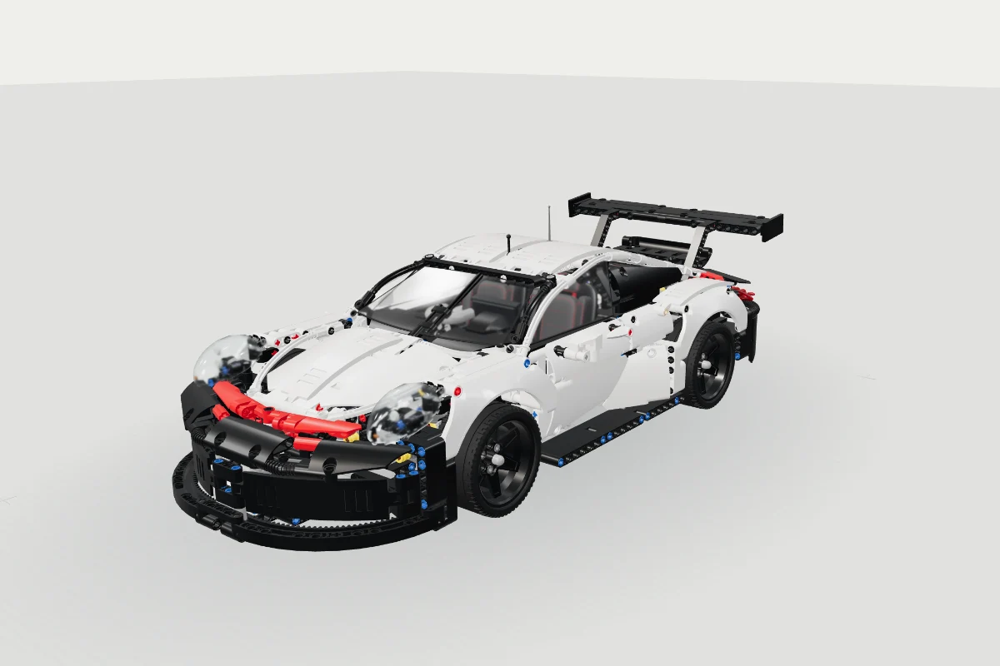
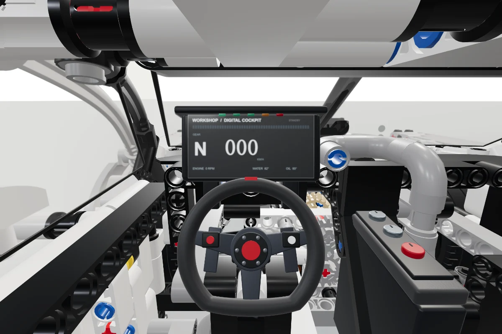
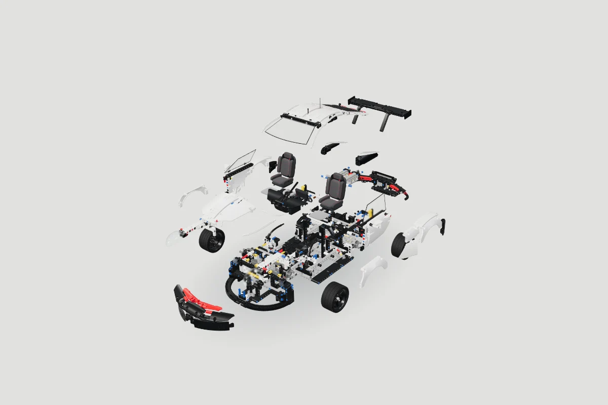
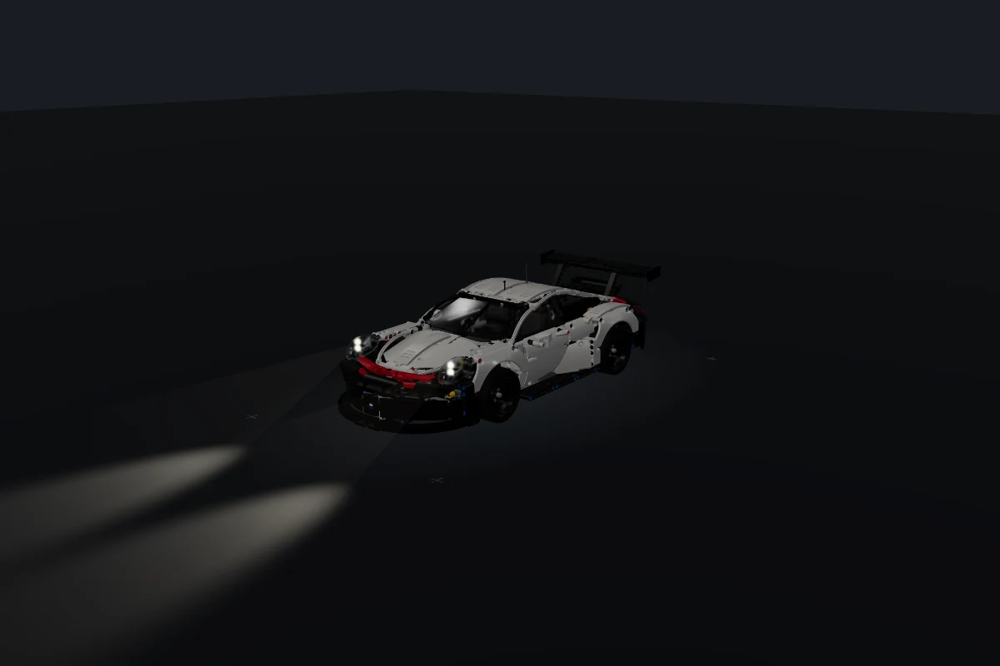

<p align="center"><strong>RSR / WORKSHOP</strong><br><sub>INDEPENDENT MECHANICAL STUDY</sub></p>

# 从驾驶座，到每一枚连接销。

一个可以驾驶、观察、拆解与重新装配的 Three.js 机械互动项目。基于社区制作的 911 RSR 积木模型，探索 **1,657 件独立部件**如何协同工作。

**[打开在线工坊 →](https://hanbuss.github.io/porsche-911-rsr-workshop/)** · [操作方式](#操作方式) · [本地运行](#本地运行) · [来源与权利](#来源与权利)

[](https://github.com/hanbuss/porsche-911-rsr-workshop/actions/workflows/pages.yml)



> 非官方、无品牌隶属的互动研究。图中模型已移除本项目后加的参考重绘品牌贴花；这不代表取得车型或商标授权。见[权利风险审查](docs/RIGHTS_REVIEW.md)。

## 四种探索方式

| 驾驶座舱 | 机械拆装 |
| --- | --- |
|  |  |
| 从方向盘后方启动、挂挡、加速；车内仪表、轮速和声音同步变化。 | 整车、车身、总成、全部零件四个阶段，再按随机编号逐件装回。 |



**开合与灯光**：左右车门、前后舱盖分别控制；前灯、尾灯、制动灯、双闪和夜间展台均可互动。**零件观察**：点击查看名称、双击靠近，支持保存当前视图。在线页的“图集与说明”可随时查看这些实际渲染及模型来源。

公开模型包含 **1,685 个节点：1,657 件物理部件 + 28 个附属细节**。每轮装配分别打乱编号和安装顺序；错误编号、重复提交不会推进进度，可选手动或自动回装。

## 操作方式

点击“驾驶视角” → 按 `I` 启动 → 等待启动完成 → 按 `E` 挂一挡 → 按住 `W` 加速。

| 按键 | 操作 | 按键 | 操作 |
| --- | --- | --- | --- |
| `I` | 启动／熄火 | `Q` / `E` | 降挡／升挡 |
| `W` / `↑` | 按住油门 | `S` / `↓` / 空格 | 按住制动 |
| `N` | 空挡 | `R` | 倒挡 |
| `Home` | 复位视角或驾驶视线 | `Esc` | 取消选择／关闭图集 |

驾驶视角中拖动环顾、滚轮调整视野，眼位保持在驾驶座；点击“外部视角”退出。外部模式支持旋转、缩放和零件选择。声音由首次点击或按键解锁。

车门或舱盖打开时油门锁定；车轮转动时禁止开合和拆解。进入驾驶视角会关闭打开的部件。拆装完成并实际归位后才能再次启动。打开图集、窗口失焦或切换到后台会释放键盘踏板输入。

车辆在展台原地展示，仪表为等效道路速度；轮速与发动机转速、挡位联动，不包含道路、轮胎抓地或碰撞求解。

## 本地运行

需要 **Node.js 22.12+**、支持 WebGL 2 的现代浏览器。

```sh
git clone https://github.com/hanbuss/porsche-911-rsr-workshop.git
cd porsche-911-rsr-workshop
npm ci
npm run dev
```

打开 <http://127.0.0.1:4180/>。首次进入会加载约 12 MB 的模型及小型皮革纹理。

```sh
npm test          # 50 项行为与几何回归
npm run build    # 生成 dist/
npm run preview  # 预览构建版
```

也可使用 `node scripts/serve.mjs` 托管 `dist/`。开发、预览、静态服务共用端口，运行其中一个即可。

## 仓库内容与部署

| 目录 | 内容 |
| --- | --- |
| `src/` | 场景、动力、声音、驾驶相机、拆装及页面交互 |
| `public/assets/` | 当前公开 GLB、零件清单、实际使用的皮革高度纹理 |
| `public/gallery/` | 本应用实际渲染的四张 WebP，README 与在线图集共用 |
| `tests/` | 行为、零件运动、回装、输入与材质回归 |
| `docs/` | 架构、来源、完整作者署名、权利审查与模型许可 |

推送 `main` 后，GitHub Actions 执行测试与构建，再发布 GitHub Pages；拉取请求仅测试和构建。运行依赖只有 Three.js，构建工具为 Vite。Vite 使用相对资源路径，可部署在仓库子路径下。

未使用的压缩 GLB 副本、两张未使用表面图、一次性诊断脚本及 glTF 离线开发依赖已移除；不提交缓存、运行回执、录屏、依赖安装目录或 API 密钥。几何与状态回归、必要的来源和许可资料保留。更多实现细节见[项目架构](docs/PROJECT.md)。

## 来源与权利

基础装配来自 [LDraw OMR 42096-1](https://library.ldraw.org/omr/sets/930)，作者 **Philippe Hurbain（Philo）**，描绘 LEGO® Technic 42096-1 Porsche 911 RSR。源装配文件声明 CC BY 2.0，实际用到的零件依其文件头适用 CC BY 2.0、CC BY 4.0 或双许可。项目新增内饰、玻璃、表面处理、运动与网页交互。

- [模型来源与公开版变更](docs/MODEL_SOURCES.md)
- [完整作者署名与依赖定义审计](docs/LDRAW_ATTRIBUTION.md)
- [版权、商标及外观风险审查](docs/RIGHTS_REVIEW.md)
- [CC BY 2.0](docs/LDraw-CCAL-2.0.txt) · [CC BY 4.0](docs/LDraw-CC-BY-4.0.txt) · [LDraw 许可说明](docs/LDraw-CAreadme.txt)
- [Three.js 与 Meshoptimizer 运行库许可通知](public/THIRD_PARTY_NOTICES.txt)

本项目与 LEGO Group、Porsche 或其他品牌无隶属关系，未获其赞助、认可或授权。名称用于识别所描绘的套装与车型，商标归相应权利人所有。公开版本移除了 15 个后加参考重绘贴花及旧静态仪表品牌图；可识别车形、名称与源几何仍有独立权利问题。免责声明不能替代许可，也不能据此保证不存在侵权风险。

LDraw 和运行库许可证只适用于各自作品，不覆盖其他品牌权利。本仓库尚未对自有源码和自制资产授予统一开源许可证；公开可读不等于可以任意复用。商业使用或再次分发前，应核对具体素材授权与适用法律。
